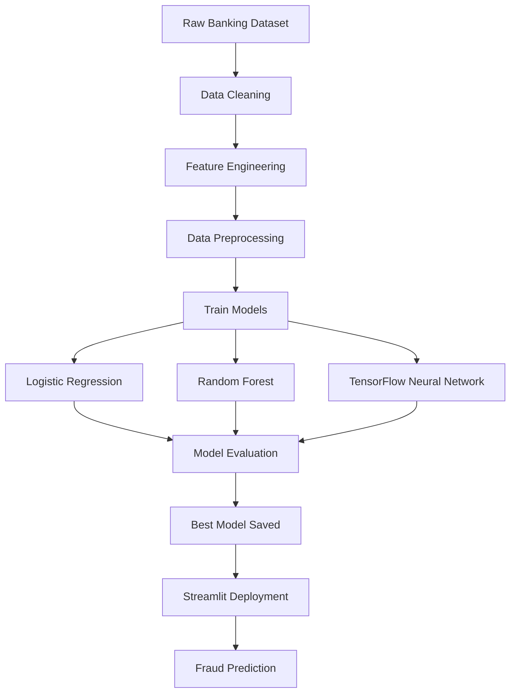
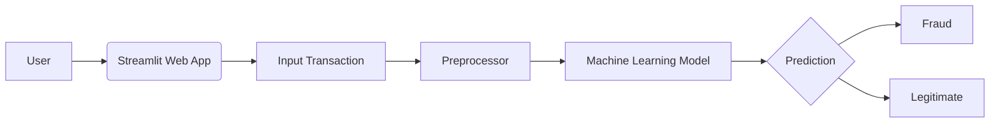
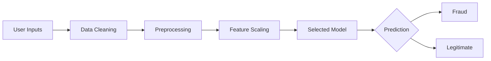
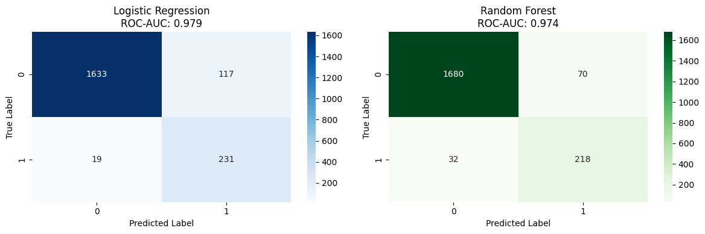
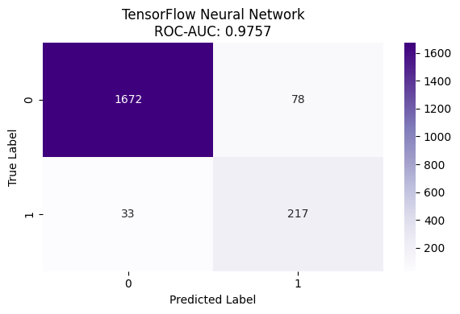

**🏦 Banking Fraud Detection**

<p align="center">
  
  
  
  
  
</p>

---

# 📌 Project Overview

The **Banking Fraud Detection System** is a Machine Learning powered web application that predicts whether a banking transaction is **Fraudulent** or **Legitimate**.

This project applies multiple Machine Learning algorithms and a Deep Learning model to analyze transaction patterns and classify fraudulent banking transactions with high accuracy.

The application is deployed using **Streamlit**, enabling users to perform fraud detection directly from their browser.

---

# 🚀 Live Demo

### 🔗 Try the Web Application

[](https://banking-fraud-detection-myssrah5gyqfl96qrkvpzx.streamlit.app/)

---

# ✨ Features

- 🏦 Banking Transaction Fraud Detection
- 🤖 Logistic Regression Model
- 🌲 Random Forest Classifier
- 🧠 TensorFlow Deep Learning Model
- 📊 Interactive Plotly Visualizations
- 📈 Banking Time-Series Analysis
- 📉 Confusion Matrix Evaluation
- 🌐 Streamlit Web Application
- ⚡ Real-time Fraud Prediction
- 💾 Pre-trained Models
# 🛠️ Technologies Used

| Technology | Purpose |
|------------|----------|
| Python | Programming Language |
| Pandas | Data Processing |
| NumPy | Numerical Computing |
| Scikit-Learn | Machine Learning |
| TensorFlow | Deep Learning |
| Streamlit | Web Application |
| Plotly | Interactive Charts |
| NetworkX | Graph Visualization |
| Joblib | Model Serialization |

---

# 🧠 Machine Learning Workflow



---

# 🏗️ Project Architecture



---

# 📂 Project Structure

```text
Banking-Fraud-Detection/
│
├── 📁 dataset_cleaning/
│   └── 📝 model_creation.ipynb          # Data cleaning & model training
│
├── 📁 IMAGES/
│   ├── 🖼️ confusion_matrix.png
│   ├── 🖼️ confusion_matrix(tensorflow).png
│   └── 🖼️ Time Series Trends & Forecast.png
│
├── 📁 MODELS/
│   ├── 🤖 logistic_regression_model.joblib
│   ├── 🌲 random_forest_model.joblib
│   ├── ⚙️ preprocessor.joblib
│   └── 🧠 tensorflow_fraud_model.keras
│
├── 🐍 app.py
├── 📊 bank_transactions.csv
├── 📦 requirements.txt
├── ⚡ runtime.txt
├── 🚫 .gitignore
└── 📖 README.md
```

# 📈 Models Used

| Model | Purpose |
|--------|---------|
| Logistic Regression | Baseline Binary Classification |
| Random Forest | Ensemble Learning |
| TensorFlow Neural Network | Deep Learning Classification |

### Model Evaluation

✔ Confusion Matrix

✔ Accuracy Score

✔ Precision

✔ Recall

✔ F1-Score

# 🔄 Prediction Pipeline



---

# 📷 Project Results

## 📊 Random Forest Confusion Matrix

<p align="center">

</p>

---

## 🧠 TensorFlow Confusion Matrix

<p align="center">

</p>

---

## 📈 Banking Transaction Time Series Analysis

<p align="center">

</p>

# ⚙️ Installation

Clone the repository

```bash
git clone https://github.com/rezumistri2026/banking-fraud-detection.git
```

Go to the project directory

```bash
cd banking-fraud-detection
```

Install dependencies

```bash
pip install -r requirements.txt
```

Run the Streamlit application

```bash
streamlit run app.py
```

---

# 📦 Requirements

```
streamlit
pandas
numpy
scikit-learn
tensorflow
plotly
networkx
joblib
```

---

# 🎯 Future Improvements

- Explainable AI (SHAP/LIME)
- XGBoost & LightGBM Models
- Real-time Banking API
- Docker Deployment
- Cloud Database Integration
- User Authentication
- Continuous Model Retraining

---

# 👨‍💻 Author

**Rezu Mistri**

🎓 B.Tech CSE (Artificial Intelligence & Machine Learning)

🏫 Brainware University

🔗 GitHub: https://github.com/rezumistri2026

---

# ⭐ Support

If you found this project helpful, consider giving it a ⭐ on GitHub!

---

# 📜 License

This project is developed for educational and learning purposes.
